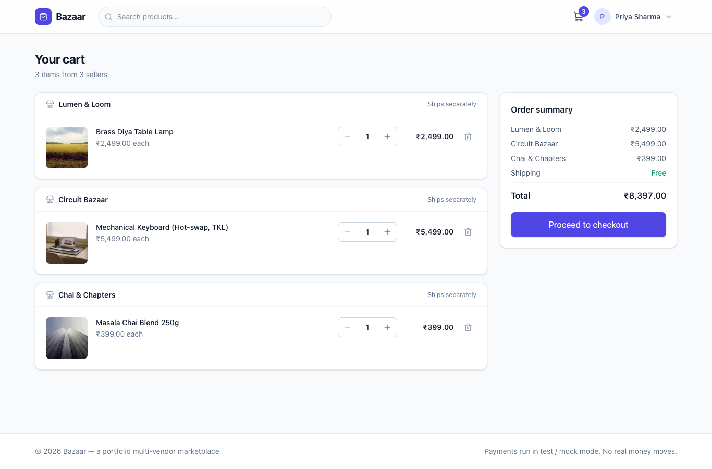
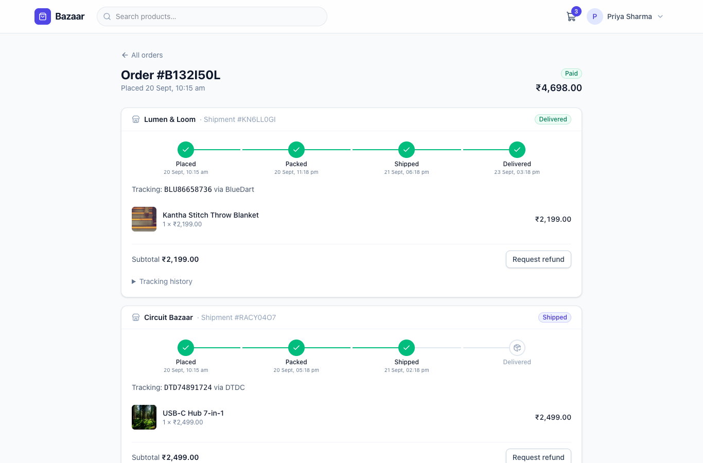
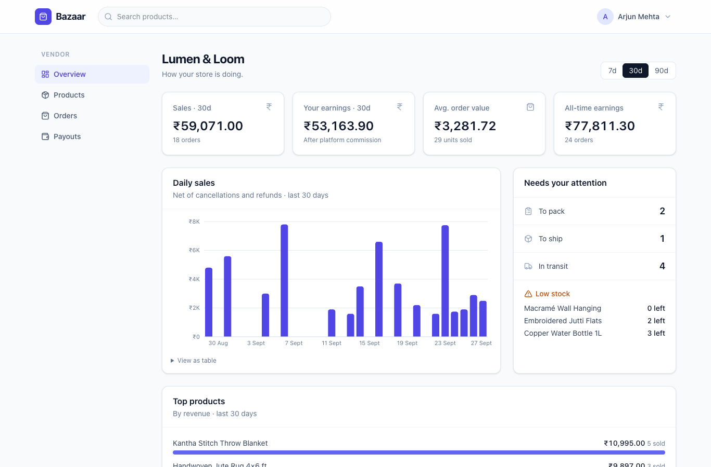
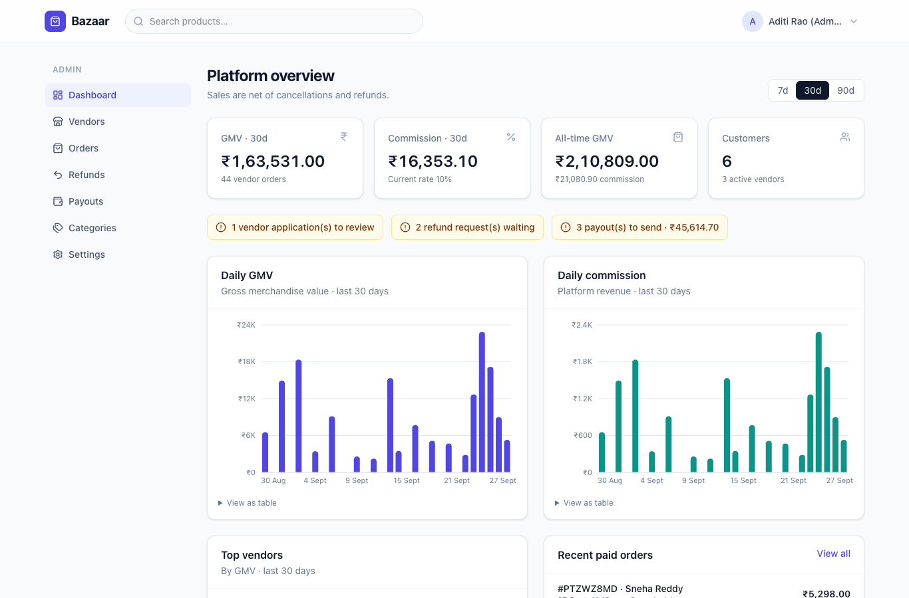
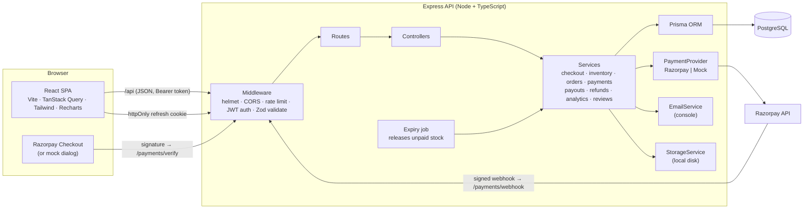
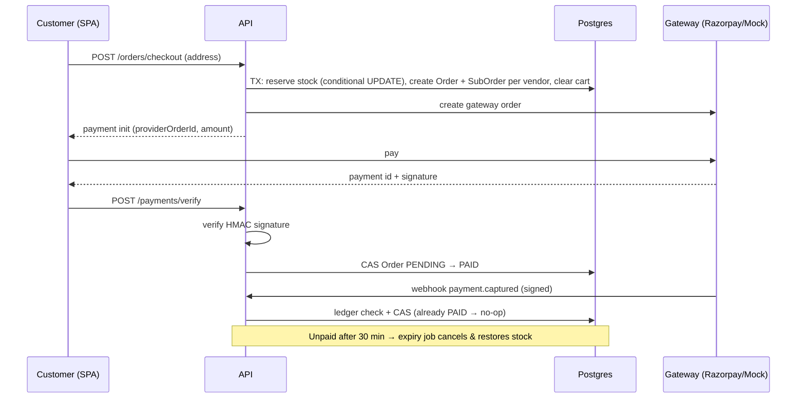
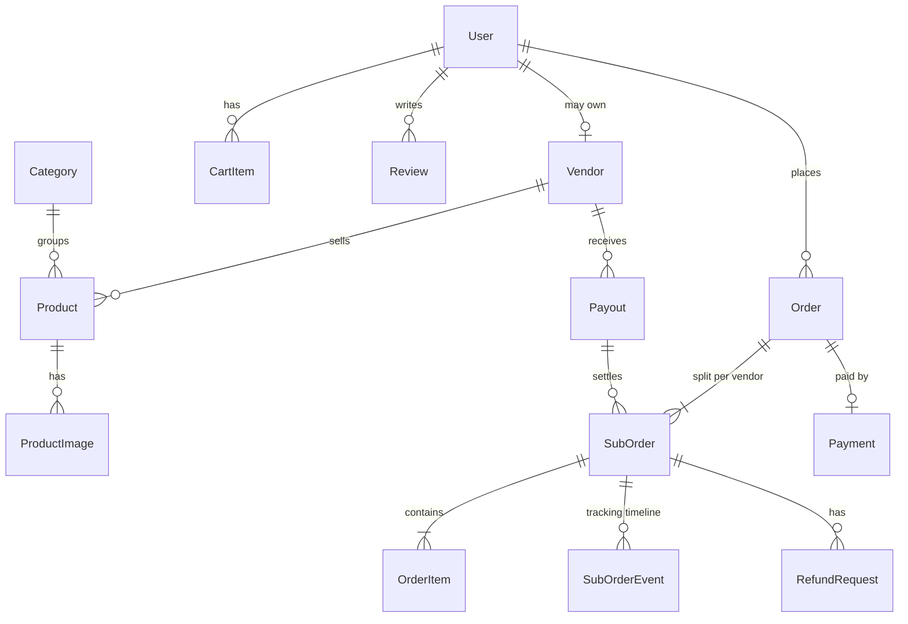

# Bazaar — Multi-Vendor Marketplace

A production-style, full-stack marketplace where independent vendors sell through one storefront.
Customers check out a **single cart containing items from many sellers**; each order is split into
**per-vendor sub-orders** that are fulfilled, tracked, cancelled and refunded independently. The
platform takes a configurable commission and batches vendor payouts.

> Portfolio project. Payments run against **Razorpay test mode** or a clearly-labelled **mock
> gateway** — no real money moves, and emails are logged to the console.


<!-- Screenshots live in docs/screenshots/ (captured from the seeded demo). -->

| | |
|---|---|
|  |  |
|  |  |

---

## Features

**Customers**
- Catalog with search, category filter, price range, in-stock filter, sorting and pagination (URL-driven, shareable)
- Product pages with image gallery, stock status, and reviews with rating distribution
- **Verified-buyer reviews only** (a delivered shipment containing the product), one per product, editable
- Multi-vendor cart grouped by seller → checkout with a shipping address
- Razorpay Checkout (test mode) or the mock gateway; retry a failed payment; items are reserved for 30 min
- Order history with **per-shipment tracking timelines**, cancel before dispatch (auto-refund), request refunds after delivery

**Vendors**
- Apply to sell → `PENDING` until an admin approves (rejected applicants can re-apply)
- Product CRUD with image uploads, stock, categories, visibility; low-stock filter
- Own orders only, with fulfilment actions: pack → ship (tracking number) → deliver, or cancel with a reason
- Analytics: daily sales chart, top products, orders needing attention, low stock
- Payout summary: paid out, processing, ready, in return window, in progress

**Admins**
- Platform dashboard: GMV, commission, daily charts, top vendors, recent orders, action alerts
- Approve / reject vendor applications
- Manage categories; view and search all orders
- Set the commission rate (applies to new orders; existing orders keep their snapshot)
- Generate payout batches and mark them paid; approve / reject refund requests

**Engineering highlights**
- **Inventory safety:** stock is reserved with a conditional atomic `UPDATE … WHERE stock >= qty`
  inside the checkout transaction, backed by a `CHECK (stock >= 0)` constraint. A concurrency test
  fires 20 simultaneous checkouts at 5 units and proves exactly 5 succeed (and it was
  mutation-tested against a naive implementation, which fails it).
- **Payments never trust the browser:** HMAC-SHA256 signature verification on the server,
  constant-time comparison, amount checks, idempotent webhooks (event ledger + compare-and-swap
  state transitions), late-capture auto-refunds, and expiry of unpaid reservations.
- **Auth:** short-lived JWT access tokens held in memory + rotating, hashed refresh tokens in an
  httpOnly cookie with reuse detection; role checks on both client and server.
- Layered backend (routes → controllers → services → Prisma), Zod validation on **every** endpoint,
  one JSON error format, helmet, CORS, rate-limited auth.
- 79 backend tests (Vitest + Supertest against a real Postgres) and 30 frontend tests (React Testing Library).

---

## Architecture



### Order & payment lifecycle



### Data model (simplified)



The full schema, API endpoint list and build checklist are in [PLAN.md](./PLAN.md). Every
non-obvious decision is recorded in [DECISIONS.md](./DECISIONS.md).

### Repository layout

```
.
├── client/                 React + Vite SPA
│   └── src/
│       ├── api/            TanStack Query hooks per domain
│       ├── auth/           AuthContext (silent refresh), ProtectedRoute
│       ├── components/     ui kit, layout, charts, product, orders, payment
│       └── pages/          shop, account, vendor, admin
├── server/                 Express + Prisma API
│   ├── prisma/             schema, migrations, seed
│   ├── src/
│   │   ├── modules/        auth, catalog, cart, orders, payments, vendor, admin, payouts, refunds, reviews, analytics
│   │   ├── services/       email, storage, payments (provider interface)
│   │   ├── middleware/     auth, validation, errors, uploads, rate limit
│   │   └── jobs/           unpaid-order expiry
│   └── tests/              Vitest + Supertest (real Postgres test DB)
├── docker-compose.yml      Postgres 16 (dev + test databases)
├── PLAN.md · DECISIONS.md
```

---

## Getting started

**Prerequisites:** Node.js ≥ 20.19 (tested on 24), npm ≥ 10, Docker.

```bash
# 1. Start Postgres (host port 5440; creates `marketplace` and `marketplace_test` DBs)
docker compose up -d

# 2. Configure environment
cp server/.env.example server/.env
cp client/.env.example client/.env
# set JWT_ACCESS_SECRET in server/.env to a long random string:
node -e "console.log(require('crypto').randomBytes(48).toString('hex'))"

# 3. Install, then generate the Prisma client, run migrations and load demo data
npm install
npm run setup          # = prisma generate + migrate deploy + seed

# 4. Run API (http://localhost:4000) and web app (http://localhost:5173)
npm run dev
```

Open **http://localhost:5173**. The Vite dev server proxies `/api` and `/uploads` to the API, so
everything is same-origin in development.

### Useful scripts (from the repo root)

| Command | What it does |
|---|---|
| `npm run dev` | API (tsx watch) + client (Vite) together |
| `npm run seed` | Wipe the **dev** database and reload demo data (deterministic) |
| `npm test` | Server tests (against `marketplace_test`) then client tests |
| `npm run lint` / `npm run typecheck` | ESLint / `tsc` in both packages |
| `npm run check` | typecheck + lint + test |
| `npm run build` | Compile the API to `server/dist` and build the SPA to `client/dist` |

> **No Docker?** Point `DATABASE_URL` / `TEST_DATABASE_URL` in `server/.env` at any PostgreSQL 14+
> instance (create both databases), then run `npm run setup`. The app relies on Postgres-specific
> behaviour (row-level locking, CHECK constraints, `mode: 'insensitive'` search), so SQLite is not
> supported — see DECISIONS.md.

### Using Razorpay test mode

Leave the keys empty to use the built-in **mock gateway** (the checkout dialog is clearly labelled).
To use Razorpay's real test environment, add your **test** keys to `server/.env`:

```env
RAZORPAY_KEY_ID=rzp_test_xxxxxxxx
RAZORPAY_KEY_SECRET=xxxxxxxx
RAZORPAY_WEBHOOK_SECRET=xxxxxxxx   # from Dashboard → Webhooks
```

The server refuses to start with non-test keys. Point a Razorpay webhook at
`https://<your-host>/api/payments/webhook` with the `payment.captured`, `payment.failed` and
`order.paid` events (use a tunnel such as ngrok for local testing).

---

## Demo accounts

All demo accounts use the password **`Password123`** (the login page has one-click buttons).

| Role | Email | Notes |
|---|---|---|
| Admin | `admin@demo.com` | Pending vendor, open refund requests and payouts waiting |
| Vendor | `vendor@demo.com` | **Lumen & Loom** — home décor, handicrafts, fashion |
| Vendor | `vendor2@demo.com` | **Circuit Bazaar** — electronics, sports |
| Vendor | `vendor3@demo.com` | **Chai & Chapters** — books, tea, wellness |
| Pending vendor | `pending@demo.com` | **Urban Threads** — application awaiting approval |
| Customer | `customer@demo.com` | Priya — order history, items in cart, can leave reviews |
| Customers | `rahul@demo.com`, `ananya@demo.com`, `vikram@demo.com`, `sneha@demo.com` | More order history |

The seed creates 45 products across 8 categories, 32 paid orders (56 vendor shipments) spread over the
last 45 days in every status, 30+ verified reviews, paid and pending payouts, and two open refund
requests.

### A 3-minute tour

1. Sign in as **customer@demo.com** → the cart already has items from three sellers → check out →
   in the mock gateway click **Pay successfully** (or try **Simulate failure**, then retry).
2. Open the order: three shipments, each with its own tracker. Cancel one: stock is restored and a
   refund is issued automatically.
3. Sign in as **vendor@demo.com** → *Orders* → pack and ship with a tracking number → deliver.
   Check *Overview* (charts) and *Payouts*.
4. Sign in as **admin@demo.com** → approve *Urban Threads*, handle the refund requests, generate
   payouts and mark one paid, change the commission rate in *Settings*.

Watch the API terminal: every notification (welcome, order confirmed, shipped, refund, payout…)
is printed by the console email service.

---

## Testing

```bash
npm test          # both packages
npm test -w server
npm test -w client
```

The server suite runs against the separate `marketplace_test` database (tables are truncated
between tests) and covers auth and token rotation, catalog, vendor products and uploads, cart and
checkout, payment signatures, webhook replay and race conditions, expiry and late captures, the
sub-order state machine, cancellations and refunds, commission, payouts, analytics and reviews,
plus the **inventory concurrency tests** in `server/tests/inventory.test.ts`.

---

## API

All endpoints live under `/api` and return JSON. Errors always look like:

```json
{ "error": { "code": "INSUFFICIENT_STOCK", "message": "Only 1 of \"Brass Diya Table Lamp\" left", "details": { "available": 1 } } }
```

See [PLAN.md § API endpoints](./PLAN.md#3-api-endpoints-api) for the full list.

---

## Deployment notes

- **API:** `npm run build -w server` then `node server/dist/index.js` (run `prisma migrate deploy`
  on release). Set `NODE_ENV=production`, a strong `JWT_ACCESS_SECRET`, `CLIENT_URL` (allowed
  origins) and `PUBLIC_API_URL`. Serve behind HTTPS so the refresh cookie gets `Secure`.
- **Client:** `npm run build -w client` produces a static bundle; set `VITE_API_URL` to the API
  origin at build time. If the SPA and API are on different sites, change the refresh cookie to
  `SameSite=None` (or put both behind one domain).
- **Uploads:** swap `LocalDiskStorage` for a Cloudinary/S3 adapter implementing `StorageService`.
- **Email:** swap `ConsoleEmailService` for an SMTP/SES/Resend adapter implementing `EmailService`.
- **Jobs:** move the unpaid-order expiry interval to a single scheduled worker when running more
  than one API instance.

## License

MIT — built as a portfolio project.
